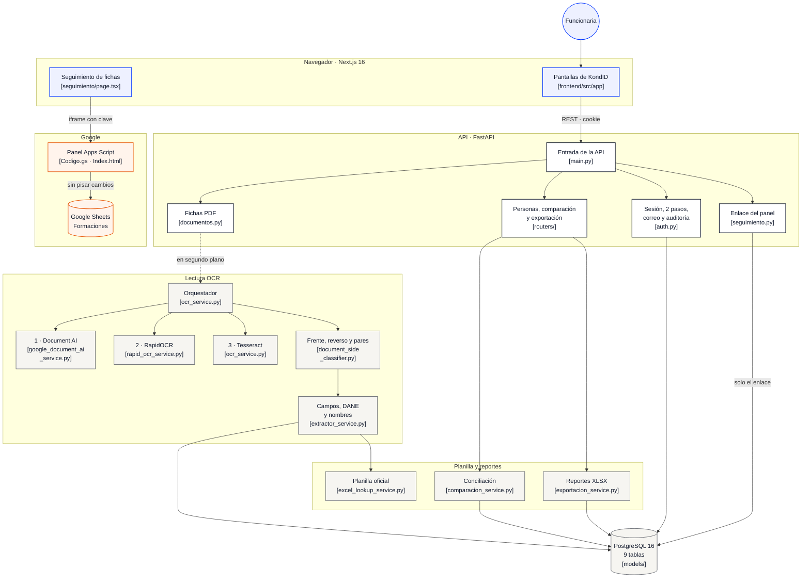

# 🔍 KondID OCR - Documentos de Identificación Colombianos

Plataforma empresarial de alta precisión para la extracción automática, clasificación, validación y comparación de documentos de identidad colombianos (Cédula de Ciudadanía tradicional, Cédula Digital, Tarjeta de Identidad). 

Cuenta con arquitectura **Smart Dual OCR** (Google Cloud Document AI + RapidOCR ONNX con fallback a Tesseract), cruce determinístico con planilla oficial Excel, visor interactivo de documentos página por página y módulo de conciliación de discrepancias. Incluye además el **Seguimiento de fichas**: un panel de Google Apps Script sobre la hoja de formaciones complementarias, que KondID muestra dentro de la app.

---

## 🏗️ Arquitectura del Sistema

```
┌────────────────────────────────────────────────────────────────────────┐
│                        CLIENTE WEB (Navegador)                         │
│                  Next.js 16 + TypeScript + Tailwind 4                  │
│                         http://localhost:3000                          │
│  • Dashboard de métricas         • Lotes PDF + Planilla oficial Excel  │
│  • Visor de páginas PDF en vivo  • Tabla interactiva de personas       │
│  • Módulo de comparación Excel   • Exportación XLSX formateada         │
│  • Usuarios y auditoría (admin)  • Seguimiento de fichas (incrustado)  │
└───────────────────────────────────┬────────────────────────────────────┘
                                    │ HTTP / REST · sesión en cookie HttpOnly (JWT)
                                    │ (el panel de Seguimiento va directo a Google: ver abajo)
┌───────────────────────────────────▼────────────────────────────────────┐
│                    BACKEND FastAPI (Python 3.12)                       │
│                        http://localhost:8000                           │
│  ┌──────────────────────────────────────────────────────────────────┐  │
│  │                     PIPELINE MULTI-MOTOR OCR                     │  │
│  │  1. PyMuPDF (texto nativo de la página o imagen a 300 DPI)       │  │
│  │  2. Google Document AI (motor principal, coordenadas 2D)         │  │
│  │  3. RapidOCR ONNX Runtime (respaldo local, zona impresa)         │  │
│  │  4. Tesseract OCR (último recurso)                               │  │
│  │  5. Clasificador de caras: Frente vs Reverso (Side Classifier)   │  │
│  │  6. Emparejamiento Frente-Reverso (Document Pairing Service)     │  │
│  │  7. Extractor Espacial 2D con Cajas Delimitadoras                │  │
│  │  8. Validación DANE (Colombia Geo) + Diccionario de Nombres      │  │
│  │  9. Cruce con Planilla Excel Oficial (nombres oficiales)         │  │
│  └──────────────────────────────────────────────────────────────────┘  │
│  • Páginas en paralelo: 4 con Document AI; con RapidOCR, 1 por núcleo  │
│  • Cancelación en caliente de procesos y remoción de archivos          │
│  • Auto-restauración de PDFs desde binario en base de datos            │
│  • Seguimiento: solo guarda el enlace del panel de cada usuario        │
└───────────────────────────────────┬────────────────────────────────────┘
                                    │ SQLAlchemy 2.0 / psycopg2
┌───────────────────────────────────▼────────────────────────────────────┐
│                       PostgreSQL 16 (puerto 5432)                      │
│   • usuarios        • documentos (con metadatos y respaldo binario)    │
│   • personas        • comparaciones        • diferencias               │
│   • auditoria       • seguimiento_config   • intentos_limitados        │
│   • sesiones_revocadas                                                 │
└───────────────────────────────────┬────────────────────────────────────┘
                                    │
┌───────────────────────────────────▼────────────────────────────────────┐
│                     pgAdmin 4 (Administración BD)                      │
│                        http://localhost:5050                           │
└────────────────────────────────────────────────────────────────────────┘
```

### Mapa del código (interactivo)

En GitHub, **cada cuadro abre su archivo o carpeta** en el repositorio. GitDiagram genera otra vista automática del repositorio en [gitdiagram.com/v44nxx/proyecto_ocr](https://gitdiagram.com/v44nxx/proyecto_ocr); la hace una IA, así que este mapa es el de referencia.



### Seguimiento de fichas: cómo se conecta

```
 Navegador (pantalla Seguimiento de KondID)
   │
   ├─(1)─▶ API KondID: GET /api/seguimiento/config ──▶ PostgreSQL (seguimiento_config)
   │         guarda solo el enlace del panel y acepta solo direcciones de Google
   │
   └─(2)─▶ iframe con sandbox: https://script.google.com/macros/s/…/exec?k=<clave>&u=<nombre>&tema=claro|oscuro
                │   la CSP del frontend solo deja incrustar dominios de Google
                ▼
          Google Apps Script (aplicación web, apps-script/seguimiento-fichas/)
                │   google.script.run: cada llamada lleva la clave y el script la verifica
                │   LockService + valor anterior: dos cambios al mismo campo no se pisan
                ▼
          Google Sheets «FORMACIONES COMPLEMENTARIAS GRUPOS»
            • pestañas REGULADA, PV, CAMPESENA y TECNOACADEMIA
            • BITACORA_PANEL (oculta): quién cambió qué, cuándo y desde dónde
            • onEdit y alCambiar (onChange) suben una versión; el panel la consulta
              cada 15 s mientras la pestaña está visible y vuelve a leer si cambió
```

El servidor de KondID nunca lee ni escribe la hoja. Los cambios del panel no se publican con Dokploy: se pegan en Apps Script como explica [apps-script/seguimiento-fichas/LEEME.md](apps-script/seguimiento-fichas/LEEME.md).

---

## ✨ Características Principales

- **OCR en cascada**, página por página:
  - **Google Cloud Document AI** (principal): texto, líneas y coordenadas 2D. Se leen 4 páginas a la vez, porque casi todo el tiempo se va en esperar a Google. Si Google responde que se pasó el límite de solicitudes, se espera 1, 2 y 4 s y se reintenta.
  - **RapidOCR ONNX Runtime** (local, sin GPU): cuando Document AI no está configurado, no hay conexión, falla o devuelve muy poco texto. Lee solo la zona impresa de la hoja y separa los nombres que lee pegados («SEBASTIANMANUEL» queda «SEBASTIAN MANUEL»).
  - **Tesseract OCR (pytesseract)**: último recurso, si los dos anteriores fallan.
  - **PyMuPDF**: las páginas de un PDF digital, que ya traen texto, se leen directo y no pasan por OCR.
- **Emparejamiento Inteligente Frente y Reverso**: Asocia automáticamente las caras de una misma cédula aunque se encuentren en páginas separadas o consecutivas.
- **Cruce con Planilla Oficial de Excel (.xlsx / .xls)**:
  - Garantiza nombres y apellidos oficiales exactos cotejados por número de cédula.
  - Detección automática de personas registradas en la planilla oficial pero no encontradas en el PDF (marcadas para revisión con alerta visual).
- **Visor Integrado de PDF**: Renderizado dinámico de páginas bajo demanda en formato JPEG (`/api/documentos/{id}/pagina/{numero}`) directamente desde el frontend.
- **Resiliencia de Archivos (Auto-restauración)**: Respaldo binario en PostgreSQL (`archivo_binario`) para regenerar PDFs físicos si se reinician contenedores o se pierden volúmenes en Dokploy/Docker.
- **Gestión y Cancelación en Vivo**: Capacidad de abortar un lote en procesamiento y purgar de inmediato registros y archivos temporales.
- **Módulo de Comparación y Conciliación**: Compara datos extraídos contra el Excel, resalta diferencias y permite correcciones inmediatas con un clic.
- **Exportación Profesional a Excel**: Generación de reportes XLSX estilizados con Pandas y OpenPyXL.
- **Seguimiento de fichas**: el panel de la hoja de formaciones complementarias dentro de KondID, con el mismo tema claro u oscuro.
  - Vistas de calendario (inician, terminan y en curso cada día), lista por urgencia y cambios (historial).
  - Alertas: ficha sin crear, sin instructor, instructor con dos formaciones a la vez, datos distintos entre pestañas y cambios recientes.
  - Lo que se guarda queda en la hoja al instante; los demás lo ven en unos 15 segundos.
- **Usuarios y auditoría** (administradores): crear y eliminar usuarios, restablecer contraseñas y la verificación en dos pasos, y consultar quién hizo cada acción.
- **Navegación rápida**:
  - El menú deja lista cada pantalla antes del clic.
  - Al volver a una pantalla se ve al instante lo de la última visita, que se actualiza en segundo plano. Esa memoria vive solo en la pestaña y se borra al cerrar sesión.
  - El refresco automático se pausa con la pestaña oculta.
- **Avisos del sistema**: sin internet, conexión lenta, servidor caído, versión nueva, sesión cerrada y descargas con datos personales.

---

## ⚡ Inicio Rápido con Docker Compose

### Prerrequisitos
- [Docker Desktop](https://www.docker.com/) instalado y en ejecución.
- Credenciales de Google Cloud Document AI (archivo `credentials/google-document-ai.json`).

### 1. Clonar y configurar entorno

```bash
git clone https://github.com/V44nxx/Proyecto_ocr.git
cd Proyecto_ocr

# Crear archivo de variables de entorno desde la plantilla
copy .env.example .env
```

Edita `.env` para ingresar tu configuración de Google Cloud y contraseñas:
```ini
ADMIN_EMAIL=admin@example.com
ADMIN_PASSWORD=una_contrasena_larga_y_propia
GOOGLE_CLOUD_PROJECT=tu-proyecto-gcp
GOOGLE_DOCUMENT_AI_LOCATION=us
GOOGLE_DOCUMENT_AI_PROCESSOR_ID=tu_processor_id_aqui
GOOGLE_DOCUMENT_AI_ENABLED=true
GOOGLE_APPLICATION_CREDENTIALS=/app/credentials/google-document-ai.json
```

Coloca tu Service Account JSON en la carpeta `credentials/`:
```bash
# credentials/google-document-ai.json
```

### 2. Levantar los contenedores

```bash
docker-compose up -d --build
```

Esto inicia automáticamente:
- **PostgreSQL 16**: puerto `5432`
- **FastAPI Backend**: puerto `8000`
- **Next.js Frontend**: puerto `3000`
- **pgAdmin 4**: puerto `5050`

### 3. Verificar estado

```bash
docker-compose ps
docker-compose logs -f backend
```

### 4. Acceso y Credenciales

El administrador inicial se crea al arrancar con `ADMIN_EMAIL` y `ADMIN_PASSWORD` si ese correo no existe; nunca se modifican usuarios existentes.

| Servicio | URL | Credenciales |
|:---------|:----|:-------------------------|
| **Frontend Web** | [http://localhost:3000](http://localhost:3000) | `ADMIN_EMAIL` / `ADMIN_PASSWORD` de tu `.env` |
| **Documentación Swagger** | [http://localhost:8000/docs](http://localhost:8000/docs) | Solo con `ENVIRONMENT` distinto de `production`; autenticación con Bearer Token |
| **Health Check API** | [http://localhost:8000/health](http://localhost:8000/health) | Acceso público |
| **pgAdmin 4** | [http://localhost:5050](http://localhost:5050) | `PGADMIN_EMAIL` / `PGADMIN_PASSWORD` de tu `.env` |

---

## 🖥️ Desarrollo Local (Sin Docker)

### Backend (Python 3.12)

```bash
cd backend

# Crear y activar entorno virtual
python -m venv .venv
.venv\Scripts\activate       # Windows PowerShell / CMD
# source .venv/bin/activate  # Linux / macOS

# Instalar dependencias
pip install -r requirements.txt

# Configurar variables de entorno locales
copy ..\.env.example .env
# Ajustar DATABASE_URL=postgresql://ocr_user:<tu_contraseña>@localhost:5432/ocr_documentos
# Ajustar GOOGLE_APPLICATION_CREDENTIALS=../credentials/google-document-ai.json

# Ejecutar el servidor de desarrollo
uvicorn app.main:app --reload --port 8000
```

### Frontend (Next.js 16)

```bash
cd frontend

# Instalar dependencias Node
npm install

# Iniciar servidor de desarrollo
npm run dev
# Disponible en http://localhost:3000
```

---

## 📊 Pipeline de Procesamiento OCR

```
                      [ PDF(s) + Planilla Excel Oficial ]
                                       ↓
                [ Validación de formato y límites de carga ]
                                       ↓
         [ Carga y normalización de la planilla oficial Excel (.xlsx) ]
                                       ↓
      [ Páginas en paralelo: 4 con Document AI; con RapidOCR, una por núcleo (2 a 4) ]
                                       ↓
                 [ PyMuPDF: ¿la página ya trae texto? ]
                   ├─ Sí (PDF digital) ─→ se usa ese texto, sin OCR
                   └─ No (escaneada) ─→ imagen a 300 DPI
                                       ↓
                      [ OCR en cascada, página por página ]
                ① Google Document AI: texto, líneas y coordenadas 2D
                   (límite de solicitudes: espera 1, 2 y 4 s y reintenta)
                ② RapidOCR, si Document AI no está, no responde, falla o lee poco:
                   solo la zona impresa de la hoja; separa nombres pegados
                ③ Tesseract, si los dos fallan
                                       ↓
                [ Clasificador de Caras (Side Classifier) ]
                   ├─ Frente (Nombres, Apellidos, Cédula)
                   └─ Reverso (Fecha de Nacimiento, Expedición, Lugar, Sexo)
                                       ↓
            [ Emparejamiento de Documentos (Pairing Service) ]
                • Unión de páginas Frente + Reverso de la misma persona
                                       ↓
              [ Extractor Espacial 2D con Cajas Delimitadoras ]
                • Proximidad de campos (NÚMERO, FECHA, LUGAR, etc.)
                • Corrección de caracteres contextuales
                • Validación DANE de municipios y departamentos
                                       ↓
            [ Cruce Determinístico con la Planilla Oficial Excel ]
                • Nombres y apellidos cotejados por cédula (100% consistencia)
                • Personas en Excel no halladas en PDF → Estado REVIEW_REQUIRED
                                       ↓
           [ Persistencia en PostgreSQL + Respaldo Binario en BD ]
                                       ↓
              [ Ejecución Automática del Módulo de Comparación ]
```

---

## 🔌 Catálogo de Endpoints API

### 🔐 Autenticación y Usuarios (`/api/auth`)
| Método | Endpoint | Descripción |
|:-------|:---------|:------------|
| `POST` | `/api/auth/login` | Iniciar sesión: pone la cookie de sesión y retorna el token JWT. A un administrador le devuelve el desafío del segundo paso |
| `POST` | `/api/auth/login/2fa` | Segundo paso de un administrador: código de la app o uno de respaldo |
| `POST` | `/api/auth/login/2fa/configurar` | Primer ingreso de un administrador: QR y clave para vincular la app de autenticación |
| `POST` | `/api/auth/login/2fa/activar` | Confirma la app con su primer código y entrega los códigos de respaldo |
| `POST` | `/api/auth/users/{user_id}/doble-factor/restablecer` | Desvincula la app de otro usuario y cierra sus sesiones (Requiere rol Admin) |
| `POST` | `/api/auth/logout` | Cerrar sesión: borra la cookie e invalida esa sesión en el servidor |
| `POST` | `/api/auth/register` | Registro de nuevo usuario (Requiere rol Admin) |
| `GET` | `/api/auth/me` | Obtener perfil del usuario autenticado |
| `GET` | `/api/auth/users` | Listar todos los usuarios (Requiere rol Admin) |
| `DELETE` | `/api/auth/users/{user_id}` | Eliminar cuenta de usuario (Requiere rol Admin) |
| `POST` | `/api/auth/users/{user_id}/password` | Asignar una contraseña nueva a otro usuario y cerrar sus sesiones (Requiere rol Admin) |
| `POST` | `/api/auth/cambiar-password` | Cambiar la contraseña propia |
| `POST` | `/api/auth/olvide-password` | Pedir por correo un enlace para restablecer la contraseña |
| `POST` | `/api/auth/restablecer-password` | Elegir una contraseña nueva con el enlace del correo |
| `GET` | `/api/auth/auditoria` | Registro de auditoría, lo más reciente primero; filtros `accion` y `email` (Requiere rol Admin) |
| `GET` | `/api/auth/health` | Verificación de estado de base de datos y backend |

### 📄 Documentos (`/api/documentos`)
| Método | Endpoint | Descripción |
|:-------|:---------|:------------|
| `POST` | `/api/documentos/upload` | Carga de lote de PDFs con **Planilla Excel obligatoria** |
| `POST` | `/api/documentos/cancelar` | Cancela procesamiento en curso y elimina archivos/registros |
| `POST` | `/api/documentos/fichas-existentes` | Antes de subir: avisa qué archivos traen un número de ficha que ya existe |
| `GET` | `/api/documentos` | Listar documentos del usuario actual |
| `GET` | `/api/documentos/{id}` | Obtener detalle y metadatos del documento |
| `GET` | `/api/documentos/{id}/personas` | Listar personas extraídas (con fallback a snapshot histórico) |
| `GET` | `/api/documentos/{id}/estado` | Consulta de progreso y paso actual en tiempo real |
| `DELETE` | `/api/documentos/{id}` | Eliminar documento y sus registros asociados |
| `GET` | `/api/documentos/dashboard/estadisticas` | Métricas agregadas para el Dashboard |
| `GET` | `/api/documentos/{id}/pagina/{numero}` | Página del PDF como imagen JPEG (la sesión va en la cookie, nunca en la dirección; no se guarda en caché) |

### 👥 Personas (`/api/personas`)
| Método | Endpoint | Descripción |
|:-------|:---------|:------------|
| `GET` | `/api/personas` | Listado paginado de personas con filtros (`buscar`, `requiere_revision`, `documento_id`) |
| `GET` | `/api/personas/{id}` | Detalle completo de una persona |
| `PUT` | `/api/personas/{id}` | Corrección manual de datos de la persona |
| `POST` | `/api/personas/{id}/subir-pdf` | Asignar PDF individual a persona cargada desde Excel |
| `DELETE` | `/api/personas/{id}` | Eliminar persona individual |
| `POST` | `/api/personas/batch-delete` | Eliminación masiva de lista de personas |
| `DELETE` | `/api/personas/vaciar/todas` | Vaciar todas las personas del usuario |
| `GET` | `/api/personas/buscar/cedula/{cedula}` | Búsqueda directa por número de identificación |

### ⚖️ Comparación y Conciliación (`/api/comparacion`)
| Método | Endpoint | Descripción |
|:-------|:---------|:------------|
| `POST` | `/api/comparacion/upload` | Subir archivo Excel para análisis de comparación |
| `POST` | `/api/comparacion/{id}/ejecutar` | Ejecutar comparación de base de datos vs archivo Excel |
| `GET` | `/api/comparacion` | Listar historial de comparaciones |
| `GET` | `/api/comparacion/{id}` | Estadísticas y resultados de una comparación |
| `GET` | `/api/comparacion/{id}/diferencias` | Detalle de discrepancias campo por campo |
| `POST` | `/api/comparacion/{id}/corregir-campo` | Aplicar corrección directa desde el comparador a la base de datos |
| `POST` | `/api/comparacion/{id}/agregar-persona-bd` | Incorporar persona faltante del Excel a la base de datos |
| `GET` | `/api/comparacion/{id}/reporte` | Descarga de informe de comparación en XLSX |

### 📥 Exportación (`/api/exportacion`)
| Método | Endpoint | Descripción |
|:-------|:---------|:------------|
| `GET` | `/api/exportacion/xlsx` | Exportar todas las personas a Excel formateado |
| `POST` | `/api/exportacion/xlsx` | Exportar selección específica de IDs a Excel |
| `GET` | `/api/exportacion/diferencias/{id}` | Exportar reporte de diferencias a Excel |

### 📅 Seguimiento de fichas (`/api/seguimiento`)
| Método | Endpoint | Descripción |
|:-------|:---------|:------------|
| `GET` | `/api/seguimiento/config` | Enlace del panel del usuario (y, si los guardó, el correo de Google y el enlace de la hoja) |
| `PUT` | `/api/seguimiento/config` | Guardar el enlace: solo acepta `script.google.com` para el panel y `docs.google.com` para la hoja |
| `DELETE` | `/api/seguimiento/config` | Quitar el panel |

### 🛠️ Sistema (`/`)
| Método | Endpoint | Descripción |
|:-------|:---------|:------------|
| `GET` | `/` | Información base del API |
| `GET` | `/health` | Chequeo de salud del servicio |
| `GET/POST`| `/api/sistema/migrar-db` | Ejecutar migración idempotente de esquemas de BD |

---

## 📁 Estructura del Repositorio

```
proyecto_ocr/
├── backend/
│   ├── app/
│   │   ├── main.py                          # Entrada principal FastAPI, middlewares y rutas
│   │   ├── config.py                        # Configuración Pydantic Settings y variables .env
│   │   ├── database.py                      # Conexión SQLAlchemy y DDL de base de datos
│   │   ├── models/                          # Modelos ORM de las 9 tablas (usuarios, documentos, personas, comparaciones,
│   │   │                                    #   diferencias, auditoria, seguimiento_config, intentos_limitados, sesiones_revocadas)
│   │   ├── schemas/                         # Esquemas Pydantic de entrada y salida
│   │   ├── routers/                         # Controladores REST (auth, documentos, personas, comparacion, exportacion, seguimiento)
│   │   ├── services/                        # Capa de lógica y orquestación de negocio
│   │   │   ├── ocr_service.py               # Orquestador del pipeline OCR multi-motor
│   │   │   ├── google_document_ai_service.py # Integración con Google Document AI (gRPC/REST)
│   │   │   ├── rapid_ocr_service.py         # Motor neural local RapidOCR ONNX
│   │   │   ├── spatial_field_extractor.py   # Extracción con geometría espacial 2D
│   │   │   ├── document_side_classifier.py  # Clasificador de cara Frente vs Reverso
│   │   │   ├── document_pairing_service.py  # Emparejador de frentes y reversos
│   │   │   ├── excel_lookup_service.py      # Búsqueda y enriquecimiento de nombres desde Excel
│   │   │   ├── comparacion_service.py       # Conciliación y detección de diferencias
│   │   │   ├── colombia_geo_service.py      # Catálogo geográfico y validación DANE
│   │   │   ├── name_dictionary_service.py   # Diccionario de nombres colombianos comunes
│   │   │   ├── exportacion_service.py       # Generador de hojas XLSX estilizadas
│   │   │   ├── correo_service.py            # Correos de recuperación de contraseña (SMTP)
│   │   │   └── auditoria.py                 # Registro de auditoría
│   │   └── utils/                           # OpenCV, logger (enmascarar_*), sesión, verificación en dos pasos, límites de intentos
│   ├── tests/                               # Pruebas pytest: unitarias, integración, seguridad y BDD (tests/bdd/*.feature)
│   ├── requirements.txt                     # Dependencias Python
│   └── Dockerfile                           # Contenedor del backend
├── frontend/
│   ├── src/
│   │   ├── app/                             # Next.js 16 App Router
│   │   │   ├── page.tsx                     # Login y autenticación
│   │   │   ├── olvide-contrasena/           # Pedir el enlace para restablecer la contraseña
│   │   │   ├── restablecer-contrasena/      # Elegir la contraseña nueva
│   │   │   ├── dashboard/                   # Métricas generales y accesos rápidos
│   │   │   ├── documentos/                  # Carga de lotes, progreso en vivo y visor PDF
│   │   │   ├── personas/                    # Tabla global, edición, filtros y subida PDF
│   │   │   ├── comparacion/                 # Módulo interactivo de resolución de diferencias
│   │   │   ├── exportacion/                 # Centro de exportación XLSX
│   │   │   ├── seguimiento/                 # Panel de Seguimiento de fichas (Google Apps Script, incrustado)
│   │   │   ├── usuarios/                    # Gestión de usuarios del sistema (administrador)
│   │   │   └── auditoria/                   # Registro de auditoría (administrador)
│   │   ├── components/                      # Componentes UI reutilizables
│   │   ├── context/                         # Contextos globales (AuthContext)
│   │   ├── hooks/                           # Hooks propios
│   │   ├── lib/                             # Cliente HTTP, datos recientes y enlaces del Seguimiento
│   │   └── types/                           # Definiciones de tipos TypeScript
│   ├── package.json                         # Dependencias Node.js
│   ├── src/proxy.ts                         # Política de contenido (CSP) con un nonce por petición
│   ├── src/app/globals.css                  # Tailwind 4: tema (@theme) y estilos globales
│   └── Dockerfile                           # Contenedor del frontend
├── apps-script/seguimiento-fichas/          # Panel de Seguimiento (Codigo.gs, Index.html, LEEME.md y pruebas con node --test)
├── pruebas/                                 # e2e (Playwright), seguridad (DAST, ZAP), carga (JMeter), OCR y rendimiento
├── docs/                                    # Documentación del sistema y de las pruebas
├── .github/workflows/                       # CI: pruebas.yml (pruebas y auditoría de dependencias) y codeql.yml
├── credentials/                             # Carpeta para Service Account de Google Cloud (no se sube al repositorio)
├── database/
│   └── init.sql                             # DDL inicial de PostgreSQL
├── docker-compose.yml                       # Orquestación de contenedores
├── .env.example                             # Plantilla de variables de entorno
├── CHANGELOG.md                             # Cambios de cada versión
├── SECURITY.md                              # Cómo reportar una falla de seguridad
├── CLAUDE.md                                # Reglas para trabajar en el repositorio (versiones, pruebas)
└── README.md                                # Documentación del proyecto
```

---

## 🎯 Comparativa de Motores OCR Implementados

| Criterio | Google Document AI | RapidOCR ONNX | Tesseract OCR |
|:---------|:------------------:|:-------------:|:-------------:|
| **Rol en el Sistema** | **Principal (Nube)** | **Respaldo local** | **Último recurso** |
| **Cuándo se usa** | Siempre que esté configurado y en línea | Sin Document AI, sin conexión, con error o con muy poco texto | Si los dos anteriores fallan |
| **Coordenadas y Layout 2D** | ✅ Bloques, párrafos y palabras | ✅ Cajas delimitadoras | ⚠️ Básico (HOCR) |
| **Tiempo por página** | ~1,5 s de espera a Google; 4 páginas a la vez | ~6,5 s en el VPS de 2 núcleos (1250 px de lado) | Medio |
| **Requerimientos** | Conexión GCP e ID de Procesador | Ninguno (corre en CPU local) | Binario Tesseract instalado |
| **Si lee mal** | — | Recorta la zona impresa y separa nombres pegados | — |

En una ficha escaneada inventada de 10 personas (20 páginas), RapidOCR acierta el 96 % de los campos desde la versión 2.17.0 (antes, 12 %). Ver el [CHANGELOG](CHANGELOG.md).

---

## 🔒 Seguridad y Buenas Prácticas

- **Cifrado de Contraseñas**: Bcrypt con 12 rondas de salting y compatibilidad passlib.
- **Tokens de Acceso**: JWT firmado con algoritmo HMAC-SHA256 y expiración configurable (por defecto 8 horas).
- **Sesión en cookie segura**: el navegador la guarda en una cookie `HttpOnly`, `SameSite=Strict` y `Secure` (prefijo `__Host-`), fuera del alcance de los scripts. Cerrar sesión la invalida en el servidor, y las peticiones que cambian datos solo se aceptan desde el frontend.
- **Verificación en dos pasos para administradores**: después de la contraseña, un código de 6 dígitos de una app de autenticación (TOTP). La primera vez se vincula la app con un QR y se entregan 10 códigos de respaldo de un solo uso. El secreto se guarda cifrado con una clave derivada de `SECRET_KEY`. Si un administrador pierde el celular y los códigos, otro administrador le restablece la verificación desde Usuarios, o en el servidor se ejecuta `python -m app.restablecer_doble_factor <correo>`.
- **Protección de Datos Multitenant**: Consultas aisladas por `usuario_id` en PostgreSQL para que ningún usuario acceda a documentos o registros de otro.
- **Validación Estricta de Archivos**: Filtro de extensiones `.pdf`, `.xlsx`, `.xls` y tamaño máximo controlado por configuración (`MAX_FILE_SIZE_MB`).
- **Respaldo Persistente**: Copia binaria de los PDFs en la base de datos para garantizar disponibilidad del visor incluso si el almacenamiento efímero se reinicia.
- **Errores sin detalles internos**: el usuario ve un mensaje genérico con una referencia (`ERR-XXXXXXXX`) y el detalle queda solo en el log.
- **Cabeceras de seguridad y CORS por lista**: API y frontend envían cabeceras contra incrustación, rastreo de tipos y filtración de la dirección de origen; el frontend aplica una política de contenido (CSP) obligatoria y la API solo acepta llamadas del navegador desde el frontend configurado.
- **Auditoría**: el administrador consulta quién inició sesión, exportó, editó o eliminó datos, y desde qué IP, sin que se guarden contraseñas ni datos de las personas.
- **Política de contraseñas**: largo mínimo y rechazo de contraseñas comunes o armadas con palabras del sistema.
- **Panel de Seguimiento**: solo abre con su clave (`?k=`), que se cambia desde el menú de la hoja. KondID lo incrusta en un marco con `sandbox`, la CSP solo permite marcos de Google y lo que se escribe en la hoja se guarda como texto, nunca como fórmula.
- **Contenedores sin privilegios**: el backend corre como el usuario `kondid` y el frontend como `nextjs`, no como root.
- **Análisis continuo**: CodeQL (GitHub Advanced Security) revisa el código en cada push y cada semana; las dependencias se revisan con pip-audit, npm audit y Snyk.
- **Pruebas**: unitarias, de integración, BDD (Gherkin en español), de interfaz, de carga y de seguridad, con regresión automática en GitHub Actions. Ver [docs/PRUEBAS.md](docs/PRUEBAS.md).
  - Backend: 585 pruebas con pytest; el CI falla si la cobertura baja del 80 %.
  - Panel de Seguimiento: 29 pruebas con `node --test`.
  - Interfaz de punta a punta: 39 casos con Playwright. Seguridad de caja negra: `pruebas/seguridad/dast_api.py`.
